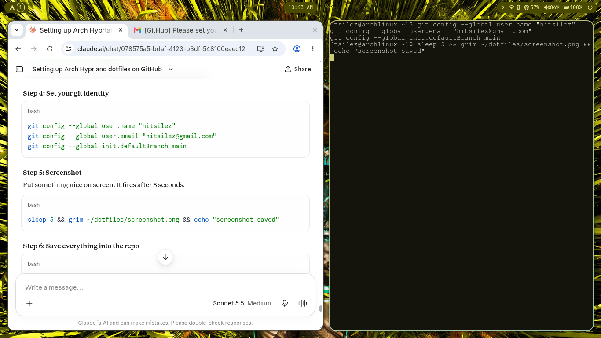

# My Arch + Hyprland dotfiles

Wallpaper-driven theming (matugen + awww), Waybar, Wofi, Mako, Alacritty/Kitty.

## Install on a fresh Arch (archinstall, minimal + NetworkManager)

    sudo pacman -S --needed git
    git clone https://github.com/hitsilez/dotfiles.git
    cd dotfiles && ./install.sh

After it finishes: reboot, log in, then connect to Wi-Fi with
`nmcli device wifi connect NAME --ask`.

